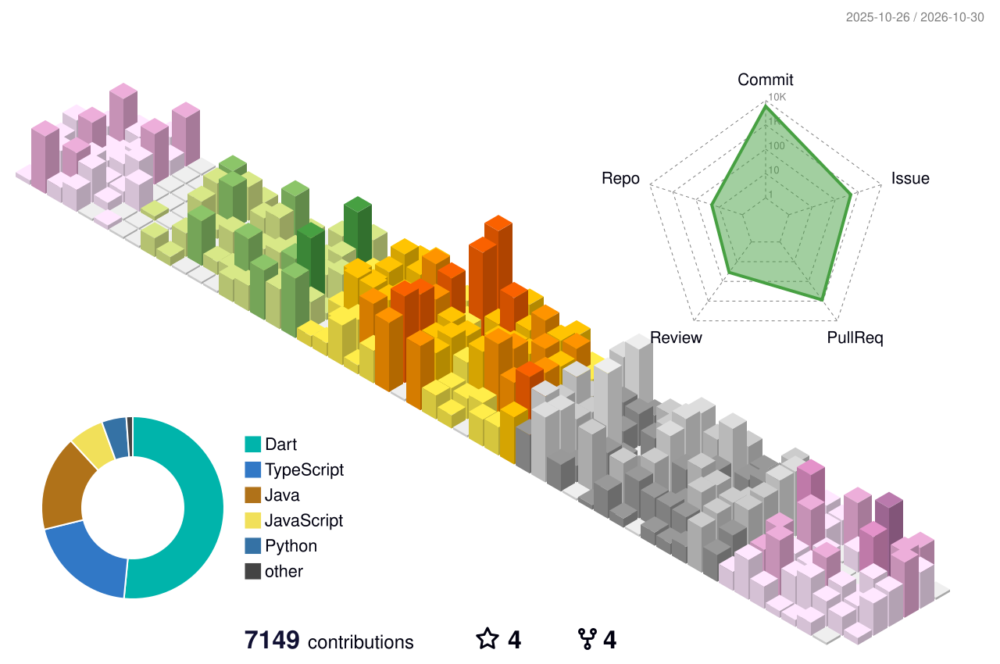

[](https://git.io/typing-svg)

# Hong Eui-min · Elipair

**Flutter Developer · Mobile & Web App Engineer**  
아이디어를 실제로 사용할 수 있는 모바일·웹 서비스로 만듭니다. — *고민은 짧게, 행동은 빠르게*

[](https://em-h20.github.io)
[](https://em-h20.github.io/portfolio.pdf)  
[](mailto:elipair0106@gmail.com)
[](https://www.linkedin.com/in/eui-min-hong)
[](https://elipair.tistory.com/)
[](https://instagram.com/e_m_hong)

> 전체 프로젝트, 수상 9건, 프로젝트별 상세 스토리는 **[em-h20.github.io](https://em-h20.github.io)** 에 정리해 두었습니다.

---

<a id="spec"></a>

## 

| 항목 | 소개 |
| :--- | :--- |
| **Focus** | Flutter 앱 개발 · 배포 자동화 · UI/UX 개선 |
| **Education** | 세종대학교 컴퓨터공학과 <br> 
| **Certification** |  |

---

<a id="featured-project"></a>

## 

### 🚔 [경찰과도둑](https://em-h20.github.io/projects/cops-and-robbers)

<a href="https://www.instagram.com/dongsim_protector">
  
</a>

**현실의 술래잡기를 연결하는 실시간 위치 기반 야외 게임 앱**  
**2025.10 – 2026** · Flutter · Android & iOS

| 항목 | 내용 |
| :--- | :--- |
| **담당 역할** | Flutter 앱 개발 · GitHub Actions/Fastlane 배포 자동화 · UX 개선 |
| **수상** | 세종 창업 아이디어 리그 **대상** 외 3건 |
| **핵심 기능** | 실시간 위치 공유 · QR 체포·초대 · 팀별 채팅 · 자동 게임 판정 |

[](https://play.google.com/store/apps/details?id=com.elipair.copsandrobbers)
[](https://apps.apple.com/us/app/cops-and-robbers-real-chase/id6756843948)
[](https://github.com/cops-and-robbers/cops-and-robbers-FE) · **[자세히 보기 →](https://em-h20.github.io/projects/cops-and-robbers)**

---

<a id="projects"></a>

## 

| 프로젝트 | 소개 | 성과 |
| :--- | :--- | :--- |
| **[Party Passport](https://em-h20.github.io/projects/party-passport)** | 파티에서 QR로 만난 사람을 스탬프로 모으고, 서로 고른 사람만 매칭되는 웹앱<br><sub>React · TypeScript · 2026.08</sub> | 🥇 Google I/O Extended: Hack the Beat 1st Place |
| **[트립게더](https://em-h20.github.io/projects/tripgether)** | SNS 게시물을 공유하면 장소 정보를 정리하는 AI 여행 가이드<br><sub>Flutter · 2025.09 – 2025.11</sub> | 세종대 창업캠프 대상 · 롯데 청년기업가대상 본선 |
| **[Stocker](https://em-h20.github.io/projects/stocker)** | 주식투자를 배우는 핀테크 교육 앱 · 팀 돔황촤 코스피<br><sub>Flutter · 2025.05 – 2025.11</sub> | Seeds 팀 프로젝트 우수상 |
| **[Block Drag](https://em-h20.github.io/projects/block-drag)** | 공간 감각을 활용하는 퍼즐 게임<br><sub>Flutter · Supabase · 2025.05 – 2025.07</sub> | Google Play · App Store 출시 |
| **[RuleBook](https://em-h20.github.io/projects/rulebook)** | 출석·벌칙·벌금을 관리하는 앱<br><sub>Flutter · 2025.03 – 2025.06</sub> | Google Play · App Store 출시 |
| **[완익세종](https://em-h20.github.io/projects/wanik-sejong)** | AI 기반 진로-교과목 로드맵 추천 서비스<br><sub>React · Next.js · 2025.12</sub> | SW-AI 해커톤 장려상 |

프로젝트 이름을 누르면 상세 페이지로 이동합니다. 나머지 프로젝트와 전체 수상 내역은 **[웹사이트](https://em-h20.github.io/#projects)** 에서 볼 수 있어요.

---

## 

| 프로젝트 | 소개 | 링크 |
| :--- | :--- | :--- |
| **Second Brain Template** | 회의·문서·이슈·의사결정을 연결하는 AI 에이전트용 Markdown 지식 관리 템플릿 | [](https://github.com/EM-H20/second-brain-template) |


---

<a id="skills"></a>

## 

| 분야 | 기술 |
| :--- | :--- |
| **Mobile** |    |
| **Frontend** |      |
| **Backend** |     |
| **Data & Realtime** |    |
| **DevOps** |       |

---

## 

### Coding Activity · WakaTime · AI

<!--START_SECTION:elipair_waka-->


**🐱 저의 GitHub 정보에요.** 

> 📦 GitHub의 909.6 kB만큼의 저장소를 사용하고 있어요. 
 > 
> 🏆 6,412 만큼의 Contributions을 2026년에 했어요
 > 
> 🚫 구직중이지 않아요.
 > 
> 📜 39개의 Public Repository를 만들었어요. 
 > 
> 🔑 9개의 Private Repository를 만들었어요. 
 > 
**저는 저녁형 인간이에요. 🦉** 

```text
🌞 아침                     31406 commits       ⬛⬛⬛⬜⬜⬜⬜⬜⬜⬜⬜⬜⬜⬜⬜⬜⬜⬜⬜⬜⬜⬜⬜⬜⬜   10.19 % 
🌆 낮　                     96786 commits       ⬛⬛⬛⬛⬛⬛⬛⬛⬜⬜⬜⬜⬜⬜⬜⬜⬜⬜⬜⬜⬜⬜⬜⬜⬜   31.40 % 
🌃 저녁                     105840 commits      ⬛⬛⬛⬛⬛⬛⬛⬛⬛⬜⬜⬜⬜⬜⬜⬜⬜⬜⬜⬜⬜⬜⬜⬜⬜   34.34 % 
🌙 밤　                     74193 commits       ⬛⬛⬛⬛⬛⬛⬜⬜⬜⬜⬜⬜⬜⬜⬜⬜⬜⬜⬜⬜⬜⬜⬜⬜⬜   24.07 % 
```
📅 **제가 가장 생산적인 날은 목요일이에요.** 

```text
월요일                      52170 commits       ⬛⬛⬛⬛⬜⬜⬜⬜⬜⬜⬜⬜⬜⬜⬜⬜⬜⬜⬜⬜⬜⬜⬜⬜⬜   16.93 % 
화요일                      37386 commits       ⬛⬛⬛⬜⬜⬜⬜⬜⬜⬜⬜⬜⬜⬜⬜⬜⬜⬜⬜⬜⬜⬜⬜⬜⬜   12.13 % 
수요일                      45624 commits       ⬛⬛⬛⬛⬜⬜⬜⬜⬜⬜⬜⬜⬜⬜⬜⬜⬜⬜⬜⬜⬜⬜⬜⬜⬜   14.80 % 
목요일                      59042 commits       ⬛⬛⬛⬛⬛⬜⬜⬜⬜⬜⬜⬜⬜⬜⬜⬜⬜⬜⬜⬜⬜⬜⬜⬜⬜   19.16 % 
금요일                      53850 commits       ⬛⬛⬛⬛⬜⬜⬜⬜⬜⬜⬜⬜⬜⬜⬜⬜⬜⬜⬜⬜⬜⬜⬜⬜⬜   17.47 % 
토요일                      23772 commits       ⬛⬛⬜⬜⬜⬜⬜⬜⬜⬜⬜⬜⬜⬜⬜⬜⬜⬜⬜⬜⬜⬜⬜⬜⬜   07.71 % 
일요일                      36381 commits       ⬛⬛⬛⬜⬜⬜⬜⬜⬜⬜⬜⬜⬜⬜⬜⬜⬜⬜⬜⬜⬜⬜⬜⬜⬜   11.80 % 
```


📊 **저는 이번주를 이렇게 시간을 보냈어요.** 

```text
🕑︎ Timezone: Asia/Seoul

💬 프로그래밍 언어들: 
Markdown                 18 hrs 21 mins      ⬛⬛⬛⬛⬛⬛⬛⬛⬛⬛⬛⬛⬛⬛⬜⬜⬜⬜⬜⬜⬜⬜⬜⬜⬜   57.82 % 
Dart                     4 hrs 48 mins       ⬛⬛⬛⬛⬜⬜⬜⬜⬜⬜⬜⬜⬜⬜⬜⬜⬜⬜⬜⬜⬜⬜⬜⬜⬜   15.16 % 
TypeScript               1 hr 49 mins        ⬛⬜⬜⬜⬜⬜⬜⬜⬜⬜⬜⬜⬜⬜⬜⬜⬜⬜⬜⬜⬜⬜⬜⬜⬜   05.76 % 
Python                   1 hr 33 mins        ⬛⬜⬜⬜⬜⬜⬜⬜⬜⬜⬜⬜⬜⬜⬜⬜⬜⬜⬜⬜⬜⬜⬜⬜⬜   04.91 % 
MDX                      1 hr 5 mins         ⬛⬜⬜⬜⬜⬜⬜⬜⬜⬜⬜⬜⬜⬜⬜⬜⬜⬜⬜⬜⬜⬜⬜⬜⬜   03.46 % 

🔥 에디터들: 
Claude Code              30 hrs 10 mins      ⬛⬛⬛⬛⬛⬛⬛⬛⬛⬛⬛⬛⬛⬛⬛⬛⬛⬛⬛⬛⬛⬛⬛⬛⬜   95.06 % 
VS Code                  1 hr 34 mins        ⬛⬜⬜⬜⬜⬜⬜⬜⬜⬜⬜⬜⬜⬜⬜⬜⬜⬜⬜⬜⬜⬜⬜⬜⬜   04.94 % 

🐱‍💻 프로젝트들: 
cops_and_robbers-FE      10 hrs 14 mins      ⬛⬛⬛⬛⬛⬛⬛⬛⬜⬜⬜⬜⬜⬜⬜⬜⬜⬜⬜⬜⬜⬜⬜⬜⬜   32.28 % 
snapcut                  5 hrs 46 mins       ⬛⬛⬛⬛⬛⬜⬜⬜⬜⬜⬜⬜⬜⬜⬜⬜⬜⬜⬜⬜⬜⬜⬜⬜⬜   18.18 % 
Big-Brother-brain        4 hrs 53 mins       ⬛⬛⬛⬛⬜⬜⬜⬜⬜⬜⬜⬜⬜⬜⬜⬜⬜⬜⬜⬜⬜⬜⬜⬜⬜   15.41 % 
EM-H20.github.io         4 hrs 14 mins       ⬛⬛⬛⬜⬜⬜⬜⬜⬜⬜⬜⬜⬜⬜⬜⬜⬜⬜⬜⬜⬜⬜⬜⬜⬜   13.36 % 
cops-and-robbers-brain   2 hrs 26 mins       ⬛⬛⬜⬜⬜⬜⬜⬜⬜⬜⬜⬜⬜⬜⬜⬜⬜⬜⬜⬜⬜⬜⬜⬜⬜   07.69 % 

💻 운영 체제들: 
Mac                      31 hrs 44 mins      ⬛⬛⬛⬛⬛⬛⬛⬛⬛⬛⬛⬛⬛⬛⬛⬛⬛⬛⬛⬛⬛⬛⬛⬛⬛   100.00 % 
```

🤖 **AI Coding This Week** 

```text
⏱ AI Coding Time: 30 hrs 43 mins (96.78%)

✍️ 14,780 lines written by AI, 11 lines written by hand (99.93% AI-written)

🔤 18,774,209 Input Tokens, 2,777,317 Output Tokens

💵 $321.18 Estimated AI Cost This Week

🧠 40 AI Sessions, 532 AI Prompts

Opus                     14,238 lines        ⬛⬛⬛⬛⬛⬛⬛⬛⬛⬛⬛⬛⬛⬛⬛⬛⬛⬛⬛⬛⬛⬛⬛⬜⬜   93.92 % 
Haiku                    916 lines           ⬛⬛⬜⬜⬜⬜⬜⬜⬜⬜⬜⬜⬜⬜⬜⬜⬜⬜⬜⬜⬜⬜⬜⬜⬜   06.04 % 
Sonnet                   5 lines             ⬜⬜⬜⬜⬜⬜⬜⬜⬜⬜⬜⬜⬜⬜⬜⬜⬜⬜⬜⬜⬜⬜⬜⬜⬜   00.03 % 
Claude-Code              0 lines             ⬜⬜⬜⬜⬜⬜⬜⬜⬜⬜⬜⬜⬜⬜⬜⬜⬜⬜⬜⬜⬜⬜⬜⬜⬜   00.00 % 

🔎 AI Coding Insights:
🤖 AI-Driven — 99.93% of written lines came from AI
📚 Verbose Prompter — average 3,244 characters per prompt
🔁 Iterative Prompter — average 13 prompts per session
🚀 High AI Trust — 0.11% of changed lines were hand-edited
```

**저는 주로 TypeScript 언어를 사용해요.** 

```text
TypeScript               16 repos            ⬛⬛⬛⬛⬛⬛⬜⬜⬜⬜⬜⬜⬜⬜⬜⬜⬜⬜⬜⬜⬜⬜⬜⬜⬜   22.54 % 
Python                   13 repos            ⬛⬛⬛⬛⬛⬜⬜⬜⬜⬜⬜⬜⬜⬜⬜⬜⬜⬜⬜⬜⬜⬜⬜⬜⬜   18.31 % 
JavaScript               10 repos            ⬛⬛⬛⬛⬜⬜⬜⬜⬜⬜⬜⬜⬜⬜⬜⬜⬜⬜⬜⬜⬜⬜⬜⬜⬜   14.08 % 
Java                     8 repos             ⬛⬛⬛⬜⬜⬜⬜⬜⬜⬜⬜⬜⬜⬜⬜⬜⬜⬜⬜⬜⬜⬜⬜⬜⬜   11.27 % 
GDScript                 1 repo              ⬜⬜⬜⬜⬜⬜⬜⬜⬜⬜⬜⬜⬜⬜⬜⬜⬜⬜⬜⬜⬜⬜⬜⬜⬜   01.41 % 
```


 Last Updated on 2026년 10월 16일 22:28:10 UTC UTC
<!--END_SECTION:elipair_waka-->


### GitHub Stats · 3D Contributions




|  |  |
|---------------------------------------------------------------------------------------------------------------------------------------------------------------------------------------------------|---------------------------------------------------------------------------------------------------------------------------------------------------------------|
|                                                                                                                                     |                              |

